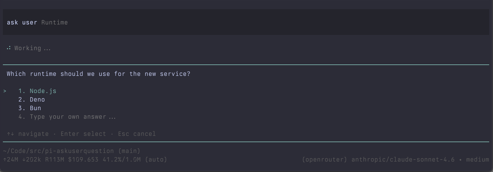
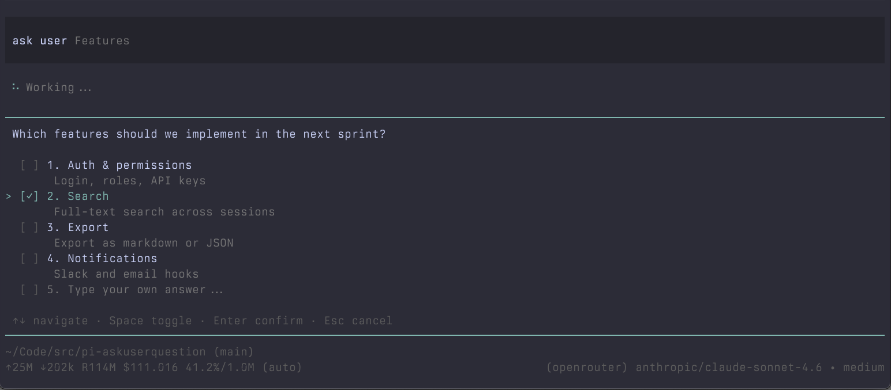
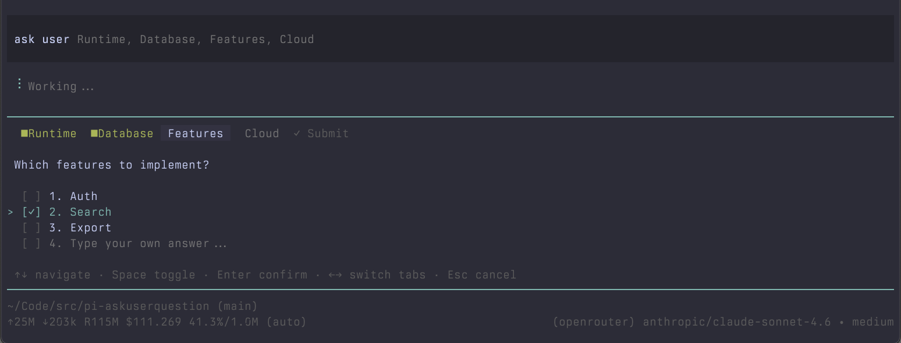
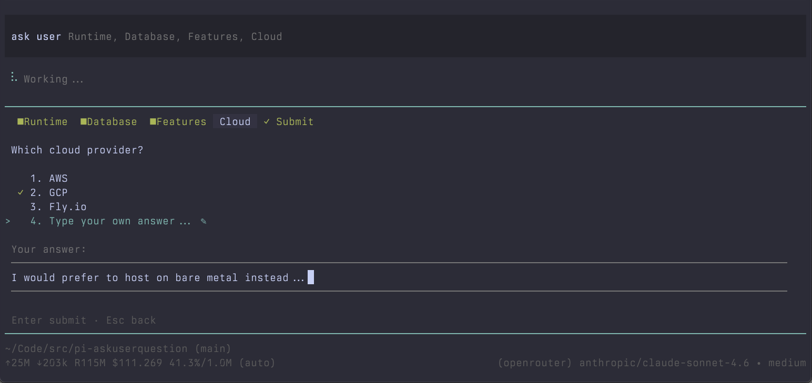
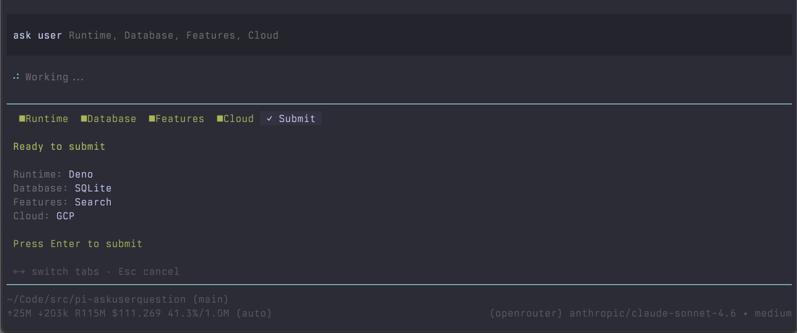

# pi-askuserquestion

A [pi coding agent](https://github.com/badlogic/pi-mono) extension that gives the LLM a structured, interactive way to ask you questions — instead of guessing or rambling, the agent pauses, presents choices, and waits for your answer.

Heavily inspired by the [`AskUserQuestion`](https://platform.claude.com/docs/en/agent-sdk/user-input#question-format) tool in Claude Code. Credit where it's due.

---

## What it looks like

**Single question — single select**



**Single question — multi select with checkboxes**



**Multiple questions — tab view**



**Free-text answer**



**Submit review**



---

## Install

```bash
pi install npm:@ghoseb/pi-askuserquestion
```

Or from git:

```bash
pi install git:github.com/ghoseb/pi-askuserquestion
```

---

## Usage

Once loaded, the tool is available to the LLM automatically. Just ask it to clarify something before proceeding:

```
Help me scaffold a new web app. Ask me what you need to know first.
```

```
I want to refactor this module. Ask me about my preferences before making changes.
```

The LLM will call `ask_user_question` with structured questions. You answer in the TUI. The answers are returned to the LLM and it continues.

---

## Tool schema

The LLM calls the tool with this shape:

```typescript
{
  questions: Array<{
    question: string;       // Full question text
    header: string;         // Short tab label (max 12 chars)
    options: Array<{
      label: string;        // Answer value returned to LLM
      description?: string; // Optional hint shown below label
    }>;                     // 2–4 options
    multiSelect: boolean;   // true = checkboxes, false = single pick
  }>                        // 1–4 questions
}
```

Answers are returned as:

```typescript
{
  answers: {
    [questionText]: "Selected Label"          // single-select
    [questionText]: "Label A, Label B"        // multi-select (joined)
    [questionText]: "user typed text"         // free-text
  }
}
```

---

## Key bindings

| Key              | Context                       | Effect                     |
|------------------|-------------------------------|----------------------------|
| `↑` `↓`          | Options list                  | Move cursor                |
| `Enter`          | Single-select option          | Confirm selection          |
| `Space`          | Checkbox option               | Toggle selection           |
| `Enter`          | Multi-select (with selection) | Confirm                    |
| `Space` or `Tab` | "Type something..." row       | Open inline editor         |
| `Enter`          | Editor (with text)            | Save and close             |
| `Enter`          | Editor (empty)                | Clear saved text and close |
| `Esc`            | Editor                        | Discard and close          |
| `←` `→`          | Multi-question tab bar        | Switch tabs                |
| `Enter`          | Submit tab (all answered)     | Submit all answers         |
| `Esc`            | Anywhere                      | Cancel entire question     |

---

## Behaviour notes

- **Cursor ≠ selection** — moving the cursor does not select an answer. Only `Enter` (single-select) or `Space` (multi-select) records a choice.
- **Auto-confirm on `→`** — navigating away from a multi-select question with selections auto-confirms it. Single-select requires explicit `Enter`.
- **Free-text + checkboxes** — on multi-select questions, you can check boxes AND type custom text. Both are included in the answer, joined by `, `.
- **Non-interactive sessions** — if called outside an interactive session (e.g. print mode), the tool disables itself for the rest of the session so the LLM won't retry.
- **Undo free-text** — re-open the editor, clear the text, press `Enter`. The saved answer is cleared.
- **Change your mind** — navigate back to any tab and re-answer. Confirmed state updates automatically.

---

## Project structure

```
src/
  schema.ts         — TypeBox schemas for tool input and result
  component.ts      — Interactive TUI component (pi-tui, no pi runtime needed)
  index.ts          — Extension entry point (registers the tool)
tests/
  component.test.ts — 108 unit tests (vitest)
```

---

## Development

```bash
pnpm install
pnpm test          # run tests
pnpm coverage      # coverage report
pnpm check         # oxlint + oxfmt check + jscpd dupe check + knip dead code
pnpm fmt           # format with oxfmt
pnpm changelog     # preview unreleased changelog entries
```

### Releasing

Commits follow [Conventional Commits](https://www.conventionalcommits.org/); `CHANGELOG.md` is generated by [git-cliff](https://git-cliff.org/).

```bash
pnpm release             # bump inferred from commits (feat → minor, fix → patch)
pnpm release minor       # or patch | major | x.y.z
git push --follow-tags
npm publish
```

`pnpm release` requires a clean tree on `main`, runs `pnpm check` and `pnpm test`, bumps `package.json`, regenerates `CHANGELOG.md`, commits `chore(release): vX.Y.Z`, and creates an annotated tag. It does not push or publish.

Load with pi for live testing:

```bash
pi -e ./src/index.ts
```

---

## License

MIT
